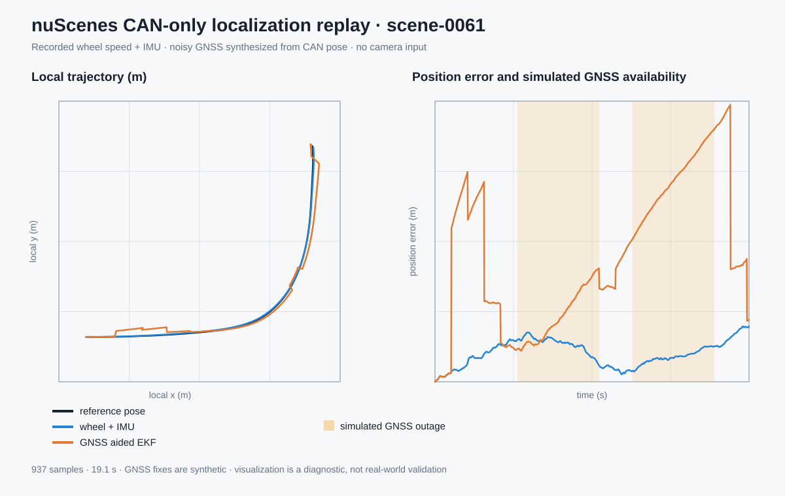

# GPS-Denied Vehicle Localization: CAN Replay Demo

A reproducible planar localization demo using nuScenes CAN bus data. It compares wheel-speed + IMU dead reckoning with an EKF that also receives simulated GNSS fixes, then measures position and heading error through scheduled GNSS outages.

> **Scope:** this is a CAN-only portfolio demo. It uses recorded wheel-speed and IMU signals, CAN pose as the evaluation reference, and synthetic GNSS generated from that pose. It does not use camera images or recorded GNSS receiver data, and it is not real-world validation.

## Results preview



The figure overlays the reference path and both estimates for `scene-0061`, then plots their position error with simulated outage windows. The ten-scene aggregate and per-scene metrics are in [the results report](docs/NUSCENES_CAN_RESULTS.md), [CSV](results/nuscenes_can_mini.csv), and [YAML](results/nuscenes_can_mini.yaml).

## Reproduce

Requires Python 3.11+ and [uv](https://docs.astral.sh/uv/). The CAN expansion files must be available in `can_bus/` or supplied through `CAN_BUS_DIR`.

```sh
make setup
make nuscenes-demo CAN_BUS_DIR=can_bus
```

This converts `scene-0061`, replays the ten official mini-scene names for the comparison, and writes the visualization to `results/nuscenes_can_scene0061.svg`. Outputs from the one-scene replay are written under the ignored `data/generated/nuscenes_scene-0061/` directory.

To run only the ten-scene metrics:

```sh
make nuscenes-can-sweep CAN_BUS_DIR=can_bus
```

The adapter and evaluation can also be run directly:

```sh
PYTHONPATH=src python -m gps_denied_localization.nuscenes_can \
  --config configs/nuscenes_can.yaml --can-bus-dir can_bus
PYTHONPATH=src python -m gps_denied_localization.nuscenes_can_sweep \
  --config configs/nuscenes_can.yaml --can-bus-dir can_bus
PYTHONPATH=src python scripts/render_nuscenes_can_demo.py
```

## Current findings

Across ten short scenes, mean outage position RMSE was 1.25 m for wheel + IMU + synthetic GNSS and 0.62 m for wheel + IMU alone. This prototype did **not** show a benefit from adding its GNSS-aided EKF; the report describes plausible reasons and the limits of this small, pose-derived experiment. The result is useful as an honest baseline and a prompt to inspect filter assumptions and sensor calibration.

## Project status and limits

- Implemented: timestamp checks, CAN stream alignment, wheel RPM conversion, local-frame pose conversion, synthetic GNSS masks, CAN-only EKF replay, ten-scene comparison, and SVG visualization.
- Camera visual odometry is out of scope for this completed version because the `v1.0-mini` camera payload is not available locally.
- CAN pose is used as evaluation truth and to generate synthetic GNSS, so the evaluation is not independent.
- nuScenes mini contains only ten short scenes. Do not interpret these values as performance guarantees or generalization claims.
- Data licensing and detailed signal assumptions are documented in [the dataset notes](docs/DATASET_PLAN.md); raw dataset files are excluded from Git.

## Other synthetic experiments

The repository also contains a controlled synthetic benchmark for sensor ablations:

```sh
make evaluate
make sweep
```

See [the roadmap](docs/ROADMAP.md), [baseline report](docs/BASELINE_RESULTS.md), [fusion report](docs/FUSION_RESULTS.md), and [multi-seed report](docs/MULTI_SEED_RESULTS.md). Synthetic camera-relative motion in that benchmark is an idealized generated stream, not image-based visual odometry.

## Safety and license

Offline research and portfolio demonstration only. This is not a certified localization system or vehicle-ready safety function. Project code is MIT licensed; third-party datasets and assets retain their own licenses.
